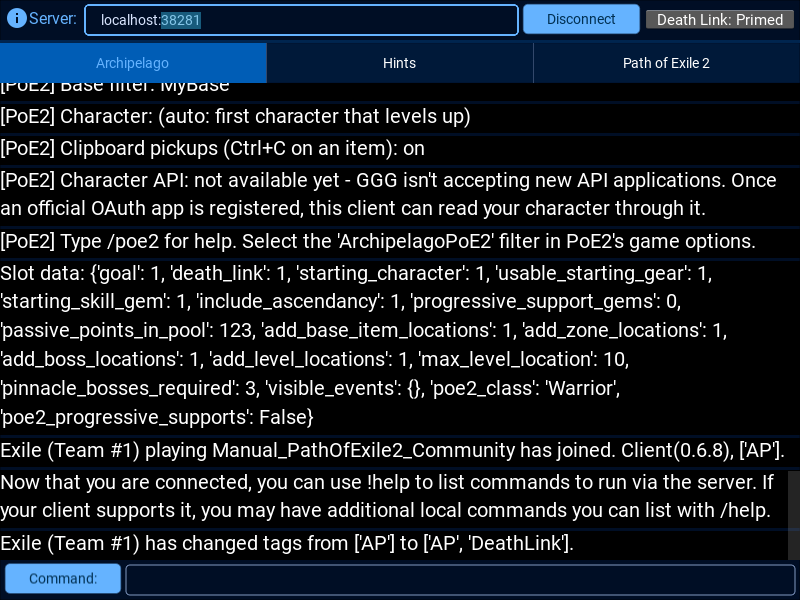

# Path of Exile 2 for Archipelago

An [Archipelago](https://archipelago.gg) world for **Path of Exile 2**, modelled on the
[Path of Exile (1) randomizer](https://stubobis1.github.io/pathofexile_ap/guide.html). You start with almost nothing
and earn skill gems, supports, passive points, gear rarity per slot, flask and charm slots, support sockets and
ascendancies as items, solo or in a multiworld with other games.

It ships as a single `.apworld` file that includes its own **PathOfExile2 Client** for the Archipelago Launcher.



## Features

- **Items:** 158 skill gems plus spirit, utility and meta gems, 300 support gem lineages, up to 123 passive points,
  progressive gear unlocks for every slot and weapon type (Normal → Magic → Rare → Unique), life/mana flask slots,
  charm slots, support sockets, ascendancies and ascendancy trials.
- **Checks:** picking up each item base, entering each campaign zone, each zone boss and the ascendancy trials,
  and reaching each level.
- **Gem pool by build:** only skill gems from your chosen skill categories (default: your class's) and the supports
  that fit them are in the pool, e.g. `skill_categories: [Class, Elemental]`.
- **Goals:** finish the campaign, finish Act 1–4, or defeat a chosen number of pinnacle bosses.
- **Logic** like PoE 1: each act needs enough usable skill gems for your weapons, gear, supports, passives and flasks.
- **Client automation** (no game memory reading, no login):
  - zones, level-ups, deaths (DeathLink) and act goals are read from PoE2's `Client.txt`;
  - pick-ups are sent by hovering an item and pressing **Ctrl+C**, with a warning if its rarity isn't unlocked yet;
  - an `ArchipelagoPoE2.filter` loot filter highlights every base you still need and keeps your normal filter below it;
  - the filter is reloaded in game automatically, and unlocks, chat from other players, hints and Ctrl+C results are
    whispered to your character within about half a second (every message category except the ones you hide; only
    while PoE2 is in front; Windows, or Linux with xdotool).
- Boss and trial checks aren't in `Client.txt`, so you click those in the client.

Gear and gem restrictions are an honor system; the client warns, it doesn't enforce.

## Install & play

1. Install [Archipelago](https://github.com/ArchipelagoMW/Archipelago/releases) 0.6.4 or newer.
2. Download `PathOfExile2.apworld` from the [Releases](../../releases) page and put it in
   Archipelago's `custom_worlds` folder.
3. Create a YAML (Launcher → **Generate Template Options**, or start from
   [`examples/PathOfExile2_example.yaml`](examples/PathOfExile2_example.yaml)) and generate/host as usual.
4. Open **PathOfExile2 Client** in the Launcher and connect.

The full rules, options and client commands are in the [setup guide](worlds/PathOfExile2/docs/setup_en.md).

## Repository layout

| Path | What it is |
|---|---|
| `worlds/PathOfExile2/` | The world: Manual framework, PoE2 data (`data/`), logic hooks (`hooks/`) and the client automation (`poe2_client.py`, `poe2_ingame.py`, `poe2_character_check.py`) |
| `tools/build_data.py` | Regenerates `data/*.json` from the [repoe-fork/poe2](https://github.com/repoe-fork/poe2) game-data export |
| `tools/build_apworld.py` | Packages the world into `dist/PathOfExile2.apworld` |
| `tools/generation_test.py` | Generates many random 6-player multiworlds to catch generation failures |
| `examples/` | Example player YAML |
| `docs/` | Screenshot (the setup guide lives in the world's `docs/` folder) |

## Development

```bash
# rebuild the game data (e.g. after a PoE2 patch)
git clone --depth 1 https://github.com/repoe-fork/poe2 ../repoe-poe2
python tools/build_data.py ../repoe-poe2 worlds/PathOfExile2

# package the .apworld
python tools/build_apworld.py

# test generation against an Archipelago source checkout with the .apworld in custom_worlds/
python tools/generation_test.py ../Archipelago 50
```

Current data: repoe-fork/poe2 export from 29 Oct 2026 (patch 0.5.x). Weapon types that aren't in the game yet
(swords, axes, daggers, claws, flails) and the Duelist are excluded; adding them for 1.0 needs small changes in
`tools/build_data.py` (`NOT_YET_IN_GAME`, `WEAPON_CLASSES`, `CLASSES`) and `hooks/poe2.py`.

**Seed compatibility:** the game ID is `PathOfExile2`. Changing it, or adding/removing
items or locations, makes older seeds incompatible — bump `world_version` in `archipelago.json` when that happens.

### Character API

PoE 1's client reads your character through GGG's official OAuth API. GGG currently isn't accepting new
applications, so this world has no character API yet. `poe2_character_check.py` already contains the gear and gem
checking, ready to be fed by an official OAuth (`account:characters`, realm `poe2`) integration later.
Session-cookie (POESESSID) access is deliberately not supported.

## Credits

- Built on [Manual for Archipelago](https://github.com/ManualForArchipelago/Manual) (MIT).
- Game data from [repoe-fork/poe2](https://github.com/repoe-fork/poe2).
- Design inspired by StuBob's [Path of Exile Archipelago](https://github.com/stubobis1/Archipelago) world.

Not affiliated with or endorsed by Grinding Gear Games.
